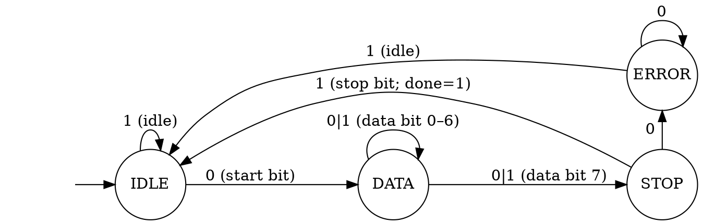
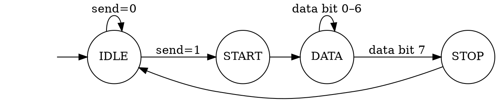

When you start out with [FPGAs](https://en.wikipedia.org/wiki/Field-programmable_gate_array), some questions come up pretty early.
One of them is: "How do I send data between my computer and the board?"

```goat
+------------+                      +------------+
|         TX |-------- line ------->| RX         |
|  Computer  |                      |    FPGA    |
|         RX |<------- line --------| TX         |
+------------+                      +------------+
```

One answer to this question is the so-called [Universal Asynchronous Receiver-Transmitter](https://en.wikipedia.org/wiki/Universal_asynchronous_receiver-transmitter), or UART.

UART is a [serial communication](https://en.wikipedia.org/wiki/Serial_communication) protocol from the 60s. It's simple, robust, and still used in lots of places.

In this post we'll go over the protocol itself, then build a [receiver](#receiver-rx) and a [transmitter](#transmitter-tx) in [SystemVerilog](https://en.wikipedia.org/wiki/SystemVerilog).
Both are pretty simple to build, and a lot of fun.

---

## Protocol

UART sends data one bit at a time, over one wire in each direction.   
When idle, the line is held **high** (`1`).

### Frame

One block of bits sent in one transmission is called a **frame**.
Its format can be configured, but it's always built from the same fields:

```goat
+---------+---------------------------+----------+----------+
|  Start  |            Data           |  Parity  |   Stop   |
+---------+---------------------------+----------+----------+
   1 Bit             5–9 Bits           Optional   1–2 Bits
```

Start
: Pulls the line from `1` (idle) to `0`. The receiver sees this edge and knows a frame has started.

Data
: The bits you're sending, [LSB](https://en.wikipedia.org/wiki/Bit_numbering) first.

Parity
: Optional [bit flip check](https://en.wikipedia.org/wiki/Parity_bit): none (`N`), even (`E`), or odd (`O`).

Stop
: Holds the line at `1` (idle), so the next start bit is recognizable again.

```wavedrom {caption="Sending the ASCII letter A (0x41) with [8N1](#settings)"}
{ signal: [
  { name: "line",  wave: "1010....101." },
  { name: "sent",  wave: "============", data: ["idle", "start", "D0", "D1", "D2", "D3", "D4", "D5", "D6", "D7", "stop", "idle"] },
  { name: "value", wave: "x==========x", data: ["0", "1", "0", "0", "0", "0", "0", "1", "0", "1"] }
]}
```

### Settings

The transmitter and receiver side must agree on the [baud rate](https://en.wikipedia.org/wiki/Baud) (`bit/s`) and the frame format:

```goat
                    115200 8N1

+-----------+-----------+-----------+-----------+
|   115200  |     8     |     N     |     1     |
+-----------+-----------+-----------+-----------+
  Baud Rate   Data Bits     Parity    Stop Bits
```

The most common setting is `8N1`.

Enough theory. How do we actually receive something?

---

## Receiver (RX)

The receiver is a module with three inputs and three outputs:

```goat
            +-------------+
   clk ---->|             |----> data[7:0]
 reset ---->|   uart_rx   |----> done
  line ---->|             |----> busy
            +-------------+
```

- `clk`: the FPGA's clock
- `reset`: restarts the receiver
- `line`: the serial input (the RX pin)
- `data`: the received byte
- `done`: high for one clock when `data` holds a new byte
- `busy`: high while a byte is being received

But what does this box actually do?
At its core, it implements the protocol from above as a [finite-state machine](https://en.wikipedia.org/wiki/Finite-state_machine) (FSM):



| State   | Condition          | Meaning        | Next state | Action                |
|---------|--------------------|----------------|------------|-----------------------|
| `IDLE`  | `line = 1`         | idle           | `IDLE`     |                       |
| `IDLE`  | `line = 0`         | start bit      | `DATA`     |                       |
| `DATA`  | `line = 0` / `1`   | data bit 0–6   | `DATA`     | store bit in `data`   |
| `DATA`  | `line = 0` / `1`   | data bit 7     | `STOP`     | store bit in `data`   |
| `STOP`  | `line = 1`         | stop bit       | `IDLE`     | `done = 1`            |
| `STOP`  | `line = 0`         |                | `ERROR`    |                       |
| `ERROR` | `line = 0`         |                | `ERROR`    |                       |
| `ERROR` | `line = 1`         | idle           | `IDLE`     |                       |

If the stop bit is `0`, the frame is broken (a *framing error*), so we wait in `ERROR` until the line is idle again.

*In code:*


```systemverilog
module uart_rx (
    input clk,
    input reset,
    input line,
    output logic [7:0] data,  // received byte
    output logic done,        // high for one clock per byte
    output logic busy         // receiving a byte
);
    localparam [1:0] IDLE = 0, DATA = 1, STOP = 2, ERROR = 3;

    logic [1:0] state;
    logic [2:0] bit_index;  // data bit 0–7

    assign busy = (state != IDLE || !line);

    always @(posedge clk) begin
        done <= 0;
        if (reset) begin
            state <= IDLE;
        end else begin
            case ({state, line})
                {IDLE, 1'b1}: state <= IDLE;
                {IDLE, 1'b0}: begin
                    state <= DATA;
                    bit_index <= 0;
                end

                {DATA, 1'b0}, {DATA, 1'b1}: begin
                    data[bit_index] <= line;
                    if (bit_index == 7) state <= STOP;
                    bit_index <= bit_index + 1;
                end

                {STOP, 1'b1}: begin
                    state <= IDLE;
                    done <= 1;
                end
                {STOP, 1'b0}: state <= ERROR;

                {ERROR, 1'b0}: state <= ERROR;
                {ERROR, 1'b1}: state <= IDLE;
            endcase
        end
    end
endmodule
```


### Clock vs. Baud (bit/s)

```wavedrom {caption="Sampling on every clock edge (orange)"}
{ signal: [
  { name: "clk",     wave: "1010101010101010101010101010", period: 0.5, node: "..A.B.C.D.E.F.G.H.I.J.K.L.M." },
  { name: "line",    wave: "1.0...1...0...", phase: 0.5 },
  { name: "sent",    wave: "=.=...=...=...", phase: 0.5, data: ["idle", "start", "D0", "D1"] },
  { name: "sampled", wave: "x=============", node: ".NOPQRSTUVWXYZ", data: ["1", "0", "0", "0", "0", "1", "1", "1", "1", "0", "0", "0", "0"] },
  { name: "state",   wave: "=.=.......==..", data: ["IDLE", "DATA", "STOP", "ERROR"] }
],
  edge: ["A-N", "B-O", "C-P", "D-Q", "E-R", "F-S", "G-T", "H-U", "I-V", "J-W", "K-X", "L-Y", "M-Z"]
}
```

UART is [asynchronous](https://en.wikipedia.org/wiki/Asynchronous_serial_communication), which means there is no shared clock between transmitter and receiver.  

Currently our FSM reads `line` as fast as it can, on every rising edge of `clk` (orange).
But one bit lasts many clock cycles (`4` in the diagram), so the FSM reads each bit several times, runs through the frame far too early and ends up in `ERROR`.

### Sampling

Instead, we read each bit only **once**, in its **middle**, far from the edges where the line changes.
To find the middle, we count clock cycles:

A counter, `clk_count`, stays at `0` while the line is idle (`line = 1`) and otherwise counts the clock cycles modulo `CLKS_PER_BIT = CLK_RATE / BIT_RATE`.
Whenever the counter reaches half of that, we sample the line.

With **4** clock cycles per bit ( as in the diagram above ) `clk_count` counts `0`–`3` and we sample at `2`:

```wavedrom {caption="Sampling in the middle of each bit (orange)"}
{ signal: [
  { name: "clk",       wave: "1010101010101010101010101010", period: 0.5, node: "........A.......B.......C..." },
  { name: "line",      wave: "1.0...1...0...", phase: 0.5 },
  { name: "sent",      wave: "=.=...=...=...", phase: 0.5, data: ["idle", "start", "D0", "D1"] },
  { name: "clk_count", wave: "=.============", data: ["0", "1", "2", "3", "0", "1", "2", "3", "0", "1", "2", "3", "0"] },
  { name: "sampled",   wave: "x...=...=...=.", node: "....D...E...F.", data: ["0", "1", "0"] },
  { name: "state",     wave: "=...=.........", data: ["IDLE", "DATA"] }
],
  edge: ["A-D", "B-E", "C-F"]
}
```

Now let's implement it. The FSM from above stays the same, it only takes a step when we sample.

*In code:*

```systemverilog {hl_lines=["1-4",13,17,"21-28","30-31",33,38]}
module uart_rx #(
    parameter CLK_RATE = 100_000_000,  // clock cycles per second
    parameter BIT_RATE = 115_200       // bit/s (baud)
) (
    input clk,
    input reset,
    input line,
    output logic [7:0] data,  // received byte
    output logic done,        // high for one clock per byte
    output logic busy         // receiving a byte
);
    localparam [1:0] IDLE = 0, DATA = 1, STOP = 2, ERROR = 3;
    localparam CLKS_PER_BIT = CLK_RATE / BIT_RATE;

    logic [1:0] state;
    logic [2:0] bit_index;  // data bit 0–7
    logic [$clog2(CLKS_PER_BIT)-1:0] clk_count;  // clocks into the bit

    assign busy = (state != IDLE || !line);

    // clock counter
    always @(posedge clk) begin
        if (reset || !busy) begin
            clk_count <= 0;
        end else begin
            clk_count <= (clk_count + 1) % CLKS_PER_BIT;
        end
    end

    // step the FSM
    wire step = (clk_count == CLKS_PER_BIT / 2);

    // finite state machine
    always @(posedge clk) begin
        done <= 0;
        if (reset) begin
            state <= IDLE;
        end else if (step) begin
            case ({state, line})
                {IDLE, 1'b1}: state <= IDLE;
                {IDLE, 1'b0}: begin
                    state <= DATA;
                    bit_index <= 0;
                end

                {DATA, 1'b0}, {DATA, 1'b1}: begin
                    data[bit_index] <= line;
                    if (bit_index == 7) state <= STOP;
                    bit_index <= bit_index + 1;
                end

                {STOP, 1'b1}: begin
                    state <= IDLE;
                    done <= 1;
                end
                {STOP, 1'b0}: state <= ERROR;

                {ERROR, 1'b0}: state <= ERROR;
                {ERROR, 1'b1}: state <= IDLE;
            endcase
        end
    end
endmodule
```


### Metastability

In 1963, while building the [LINC](https://en.wikipedia.org/wiki/LINC) computer, Charles Molnar noticed that it occasionally jumped to the wrong instruction.
The cause was an input that changed right at a clock edge.
Journals rejected his findings, because people did not believe [flip-flops](https://en.wikipedia.org/wiki/Flip-flop_(electronics)) could be anything but `0` or `1`.
It took until [1973](https://ibm1401.computerhistory.org/AnomalousSynchronizer_ChaneyMolnar_IEEE1973.pdf) for the problem to be published.
Today it's called [metastability](https://en.wikipedia.org/wiki/Metastability_(electronics)), and our receiver has it too:

```wavedrom {caption="line changes right at a clock edge (orange): the counter and the FSM read different values"}
{ signal: [
  { name: "clk",          wave: "10101010101010", period: 0.5, node: "....A........." },
  { name: "line",         wave: "1.0...." },
  { name: "counter sees", wave: "1...x0........", period: 0.5 },
  { name: "FSM sees",     wave: "1...x10.......", period: 0.5, node: "....B........." }
],
  edge: ["A-B"]
}
```

`line` comes from outside the FPGA and *can* change right at a clock edge.
A flip-flop sampling it then can get stuck between `0` and `1`, so parts of our logic read different values.

The fix is a *synchronizer*: two flip-flops in a row.
The first gets a whole clock cycle to settle before the second one reads it.

```systemverilog
logic line_meta, line_sync;

always @(posedge clk) begin
    line_meta <= line;
    line_sync <= line_meta;
end
```

```wavedrom {caption="line changes right at a clock edge: line_meta is briefly undefined, line_sync stays clean (orange)"}
{ signal: [
  { name: "clk",       wave: "10101010101010", period: 0.5, node: "....A.C......." },
  { name: "line",      wave: "1.0...." },
  { name: "line_meta", wave: "1...x0........", period: 0.5, node: "....B........." },
  { name: "line_sync", wave: "1..0...", node: "...D..." }
],
  edge: ["A-B", "C-D"]
}
```

From now on, the receiver uses `line_sync` instead of `line`.

*In code:*

```systemverilog {hl_lines=[18,"20-24",26,46,54]}
module uart_rx #(
    parameter CLK_RATE = 100_000_000,  // clock cycles per second
    parameter BIT_RATE = 115_200       // bit/s (baud)
) (
    input clk,
    input reset,
    input line,
    output logic [7:0] data,  // received byte
    output logic done,        // high for one clock per byte
    output logic busy         // receiving a byte
);
    localparam [1:0] IDLE = 0, DATA = 1, STOP = 2, ERROR = 3;
    localparam CLKS_PER_BIT = CLK_RATE / BIT_RATE;

    logic [1:0] state;
    logic [2:0] bit_index;  // data bit 0–7
    logic [$clog2(CLKS_PER_BIT)-1:0] clk_count;  // clocks into the bit
    logic line_meta, line_sync;

    // synchronizer
    always @(posedge clk) begin
        line_meta <= line;
        line_sync <= line_meta;
    end

    assign busy = (state != IDLE || !line_sync);

    // clock counter
    always @(posedge clk) begin
        if (reset || !busy) begin
            clk_count <= 0;
        end else begin
            clk_count <= (clk_count + 1) % CLKS_PER_BIT;
        end
    end

    // step the FSM
    wire step = (clk_count == CLKS_PER_BIT / 2);

    // finite state machine
    always @(posedge clk) begin
        done <= 0;
        if (reset) begin
            state <= IDLE;
        end else if (step) begin
            case ({state, line_sync})
                {IDLE, 1'b1}: state <= IDLE;
                {IDLE, 1'b0}: begin
                    state <= DATA;
                    bit_index <= 0;
                end

                {DATA, 1'b0}, {DATA, 1'b1}: begin
                    data[bit_index] <= line_sync;
                    if (bit_index == 7) state <= STOP;
                    bit_index <= bit_index + 1;
                end

                {STOP, 1'b1}: begin
                    state <= IDLE;
                    done <= 1;
                end
                {STOP, 1'b0}: state <= ERROR;

                {ERROR, 1'b0}: state <= ERROR;
                {ERROR, 1'b1}: state <= IDLE;
            endcase
        end
    end
endmodule
```



```systemverilog {hl_lines=["16-18",22,35,38,43]}
// Same receiver, without the modulo. Verilator rejects mixed bit widths,
// so the counter resets itself at LAST and every width is written out.
module uart_rx #(
    parameter CLK_RATE = 100_000_000,  // clock cycles per second
    parameter BIT_RATE = 115_200       // bit/s (baud)
) (
    input clk,
    input reset,
    input line,
    output logic [7:0] data,  // received byte
    output logic done,        // high for one clock per byte
    output logic busy         // receiving a byte
);
    localparam [1:0] IDLE = 0, DATA = 1, STOP = 2, ERROR = 3;
    localparam CLKS_PER_BIT = CLK_RATE / BIT_RATE;
    localparam WIDTH = $clog2(CLKS_PER_BIT);
    localparam [WIDTH-1:0] LAST = WIDTH'(CLKS_PER_BIT - 1);    // last clock of a bit
    localparam [WIDTH-1:0] MIDDLE = WIDTH'(CLKS_PER_BIT / 2);  // middle of a bit

    logic [1:0] state;
    logic [2:0] bit_index;  // data bit 0–7
    logic [WIDTH-1:0] clk_count;  // clocks into the bit
    logic line_meta, line_sync;

    // synchronizer
    always @(posedge clk) begin
        line_meta <= line;
        line_sync <= line_meta;
    end

    assign busy = (state != IDLE || !line_sync);

    // clock counter
    always @(posedge clk) begin
        if (reset || !busy || clk_count == LAST) begin
            clk_count <= 0;
        end else begin
            clk_count <= clk_count + 1;
        end
    end

    // step the FSM
    wire step = (clk_count == MIDDLE);

    // finite state machine
    always @(posedge clk) begin
        done <= 0;
        if (reset) begin
            state <= IDLE;
        end else if (step) begin
            case ({state, line_sync})
                {IDLE, 1'b1}: state <= IDLE;
                {IDLE, 1'b0}: begin
                    state <= DATA;
                    bit_index <= 0;
                end

                {DATA, 1'b0}, {DATA, 1'b1}: begin
                    data[bit_index] <= line_sync;
                    if (bit_index == 7) state <= STOP;
                    bit_index <= bit_index + 1;
                end

                {STOP, 1'b1}: begin
                    state <= IDLE;
                    done <= 1;
                end
                {STOP, 1'b0}: state <= ERROR;

                {ERROR, 1'b0}: state <= ERROR;
                {ERROR, 1'b1}: state <= IDLE;
            endcase
        end
    end
endmodule
```



```systemverilog
`timescale 1ns / 1ps

module uart_rx_tb;
    localparam CLK_RATE = 100_000_000;
    localparam BIT_RATE = 115_200;
    localparam real BIT_TIME = 1e9 / BIT_RATE;  // ns per bit

    logic clk = 0;
    logic reset = 1;
    logic line = 1;
    logic [7:0] data;
    logic done, busy;

    uart_rx #(
        .CLK_RATE(CLK_RATE),
        .BIT_RATE(BIT_RATE)
    ) rx (
        .clk(clk),
        .reset(reset),
        .line(line),
        .data(data),
        .done(done),
        .busy(busy)
    );

    always #5 clk = ~clk;  // 100 MHz

    // send one byte, like the computer would
    task send(input [7:0] value);
        line = 0;  // start bit
        #BIT_TIME;
        for (int i = 0; i < 8; i++) begin
            line = value[i];  // data bits, LSB first
            #BIT_TIME;
        end
        line = 1;  // stop bit
        #BIT_TIME;
    endtask

    always @(posedge clk) begin
        if (done) $display("received %c (0x%h)", data, data);
    end

    initial begin
        $dumpfile("uart_rx_tb.vcd");
        $dumpvars(0, uart_rx_tb);

        #100 reset = 0;
        send("H");
        send("i");
        $finish;
    end
endmodule
```


That's it: you've just built a complete UART receiver! 🎉

---

## Transmitter (TX)

The transmitter is the receiver in reverse: it takes a byte and puts it on the line, bit by bit.
It's a module with four inputs and two outputs:

```goat
               +-------------+
      clk ---->|             |
    reset ---->|             |----> line
data[7:0] ---->|   uart_tx   |----> busy
     send ---->|             |
               +-------------+
```

- `clk`: the FPGA's clock
- `reset`: restarts the transmitter
- `data`: the byte to send
- `send`: high for one clock to start sending `data`
- `line`: the serial output (the TX pin)
- `busy`: high while a byte is being sent

Like the receiver, it's an FSM. But instead of reading the line, it drives it:



| State   | Condition  | Meaning        | Next state | Action                    |
|---------|------------|----------------|------------|---------------------------|
| `IDLE`  | `send = 0` | idle           | `IDLE`     | `line = 1`                |
| `IDLE`  | `send = 1` | send a byte    | `START`    | `line = 1`, copy `data`   |
| `START` |            | start bit      | `DATA`     | `line = 0`                |
| `DATA`  |            | data bit 0–6   | `DATA`     | `line =` data bit         |
| `DATA`  |            | data bit 7     | `STOP`     | `line =` data bit         |
| `STOP`  |            | stop bit       | `IDLE`     | `line = 1`                |

Sending a byte takes a while. So when `send` is high, we copy `data` into `buffer` and send from there.
That way `data` can already change while the byte is still being sent.

*In code:*


```systemverilog
module uart_tx (
    input clk,
    input reset,
    input [7:0] data,   // byte to send
    input send,         // high for one clock to send data
    output logic line,
    output logic busy   // sending a byte
);
    localparam [1:0] IDLE = 0, START = 1, DATA = 2, STOP = 3;

    logic [1:0] state;
    logic [2:0] bit_index;  // data bit 0–7
    logic [7:0] buffer;     // copy of data

    assign busy = (state != IDLE);

    // finite state machine
    always @(posedge clk) begin
        if (reset) begin
            state <= IDLE;
        end else begin
            case ({state, send})
                {IDLE, 1'b0}: state <= IDLE;
                {IDLE, 1'b1}: begin
                    state <= START;
                    buffer <= data;
                    bit_index <= 0;
                end

                {START, 1'b0}, {START, 1'b1}: state <= DATA;

                {DATA, 1'b0}, {DATA, 1'b1}: begin
                    if (bit_index == 7) state <= STOP;
                    bit_index <= bit_index + 1;
                end

                {STOP, 1'b0}, {STOP, 1'b1}: state <= IDLE;
            endcase
        end
    end

    // line output
    always @(posedge clk) begin
        case (state)
            IDLE:  line <= 1;
            START: line <= 0;
            DATA:  line <= buffer[bit_index];
            STOP:  line <= 1;
        endcase
    end
endmodule
```


### Clock vs. Baud (bit/s)

```wavedrom {caption="A new bit on every clock edge (orange)"}
{ signal: [
  { name: "clk",   wave: "1010101010101010101010101010", period: 0.5, node: "......A.B.C.D.E.F.G.H.I.J..." },
  { name: "send",  wave: "010..........." },
  { name: "state", wave: "=.==.......==.", data: ["IDLE", "START", "DATA", "STOP", "IDLE"] },
  { name: "line",  wave: "1..010....101.", node: "...KLMNOPQRST." },
  { name: "sent",  wave: "=..===========", data: ["idle", "start", "D0", "D1", "D2", "D3", "D4", "D5", "D6", "D7", "stop", "idle"] }
],
  edge: ["A-K", "B-L", "C-M", "D-N", "E-O", "F-P", "G-Q", "H-R", "I-S", "J-T"]
}
```

But our transmitter now has the same problem as the receiver: its FSM takes a step on every rising edge of `clk` (orange), so each bit lasts only **one** clock cycle.
One bit has to last `CLKS_PER_BIT` clock cycles (`4` in the next diagram).

### Holding each bit

So we hold each bit, using the same counter as in the receiver:
`clk_count` stays at `0` while idle and otherwise counts the clock cycles modulo `CLKS_PER_BIT`.
On its last count (`CLKS_PER_BIT - 1`), the FSM moves on to the next bit.

With **4** clock cycles per bit, `clk_count` counts `0`–`3` and the FSM steps at `3`:

```wavedrom {caption="Each bit lasts 4 clocks: the FSM steps at clk_count = 3 (orange)"}
{ signal: [
  { name: "clk",       wave: "1010101010101010101010101010", period: 0.5, node: "............A.......B......." },
  { name: "send",      wave: "010..........." },
  { name: "state",     wave: "=.=...=...=...", node: "......C...D...", data: ["IDLE", "START", "DATA", "DATA"] },
  { name: "clk_count", wave: "=..===========", data: ["0", "1", "2", "3", "0", "1", "2", "3", "0", "1", "2", "3"] },
  { name: "line",      wave: "1..0...1...0.." },
  { name: "sent",      wave: "=..=...=...=..", data: ["idle", "start", "D0", "D1"] }
],
  edge: ["A-C", "B-D"]
}
```

Now let's implement it. The FSM from above stays the same, it only takes a step when idle or on the last clock of a bit.

*In code:*

```systemverilog {hl_lines=["1-4",13,18,"22-29","31-32",38]}
module uart_tx #(
    parameter CLK_RATE = 100_000_000,  // clock cycles per second
    parameter BIT_RATE = 115_200       // bit/s (baud)
) (
    input clk,
    input reset,
    input [7:0] data,   // byte to send
    input send,         // high for one clock to send data
    output logic line,
    output logic busy   // sending a byte
);
    localparam [1:0] IDLE = 0, START = 1, DATA = 2, STOP = 3;
    localparam CLKS_PER_BIT = CLK_RATE / BIT_RATE;

    logic [1:0] state;
    logic [2:0] bit_index;  // data bit 0–7
    logic [7:0] buffer;     // copy of data
    logic [$clog2(CLKS_PER_BIT)-1:0] clk_count;  // clocks into the bit

    assign busy = (state != IDLE);

    // clock counter
    always @(posedge clk) begin
        if (reset || !busy) begin
            clk_count <= 0;
        end else begin
            clk_count <= (clk_count + 1) % CLKS_PER_BIT;
        end
    end

    // step the FSM
    wire step = (state == IDLE || clk_count == CLKS_PER_BIT - 1);

    // finite state machine
    always @(posedge clk) begin
        if (reset) begin
            state <= IDLE;
        end else if (step) begin
            case ({state, send})
                {IDLE, 1'b0}: state <= IDLE;
                {IDLE, 1'b1}: begin
                    state <= START;
                    buffer <= data;
                    bit_index <= 0;
                end

                {START, 1'b0}, {START, 1'b1}: state <= DATA;

                {DATA, 1'b0}, {DATA, 1'b1}: begin
                    if (bit_index == 7) state <= STOP;
                    bit_index <= bit_index + 1;
                end

                {STOP, 1'b0}, {STOP, 1'b1}: state <= IDLE;
            endcase
        end
    end

    // line output
    always @(posedge clk) begin
        case (state)
            IDLE:  line <= 1;
            START: line <= 0;
            DATA:  line <= buffer[bit_index];
            STOP:  line <= 1;
        endcase
    end
endmodule
```



```systemverilog {hl_lines=[16,17,22,28,31,36]}
// Same transmitter, without the modulo. Verilator rejects mixed bit widths,
// so the counter resets itself at LAST and every width is written out.
module uart_tx #(
    parameter CLK_RATE = 100_000_000,  // clock cycles per second
    parameter BIT_RATE = 115_200       // bit/s (baud)
) (
    input clk,
    input reset,
    input [7:0] data,   // byte to send
    input send,         // high for one clock to send data
    output logic line,
    output logic busy   // sending a byte
);
    localparam [1:0] IDLE = 0, START = 1, DATA = 2, STOP = 3;
    localparam CLKS_PER_BIT = CLK_RATE / BIT_RATE;
    localparam WIDTH = $clog2(CLKS_PER_BIT);
    localparam [WIDTH-1:0] LAST = WIDTH'(CLKS_PER_BIT - 1);  // last clock of a bit

    logic [1:0] state;
    logic [2:0] bit_index;  // data bit 0–7
    logic [7:0] buffer;     // copy of data
    logic [WIDTH-1:0] clk_count;  // clocks into the bit

    assign busy = (state != IDLE);

    // clock counter
    always @(posedge clk) begin
        if (reset || !busy || clk_count == LAST) begin
            clk_count <= 0;
        end else begin
            clk_count <= clk_count + 1;
        end
    end

    // step the FSM
    wire step = (state == IDLE || clk_count == LAST);

    // finite state machine
    always @(posedge clk) begin
        if (reset) begin
            state <= IDLE;
        end else if (step) begin
            case ({state, send})
                {IDLE, 1'b0}: state <= IDLE;
                {IDLE, 1'b1}: begin
                    state <= START;
                    buffer <= data;
                    bit_index <= 0;
                end

                {START, 1'b0}, {START, 1'b1}: state <= DATA;

                {DATA, 1'b0}, {DATA, 1'b1}: begin
                    if (bit_index == 7) state <= STOP;
                    bit_index <= bit_index + 1;
                end

                {STOP, 1'b0}, {STOP, 1'b1}: state <= IDLE;
            endcase
        end
    end

    // line output
    always @(posedge clk) begin
        case (state)
            IDLE:  line <= 1;
            START: line <= 0;
            DATA:  line <= buffer[bit_index];
            STOP:  line <= 1;
        endcase
    end
endmodule
```



```systemverilog
`timescale 1ns / 1ps

module uart_tx_tb;
    localparam CLK_RATE = 100_000_000;
    localparam BIT_RATE = 115_200;

    logic clk = 0;
    logic reset = 1;
    logic [7:0] data;
    logic send = 0;
    logic line, busy;

    logic [7:0] received;
    logic done, rx_busy;

    uart_tx #(
        .CLK_RATE(CLK_RATE),
        .BIT_RATE(BIT_RATE)
    ) tx (
        .clk(clk),
        .reset(reset),
        .data(data),
        .send(send),
        .line(line),
        .busy(busy)
    );

    // our receiver listens on the same line
    uart_rx #(
        .CLK_RATE(CLK_RATE),
        .BIT_RATE(BIT_RATE)
    ) rx (
        .clk(clk),
        .reset(reset),
        .line(line),
        .data(received),
        .done(done),
        .busy(rx_busy)
    );

    always #5 clk = ~clk;  // 100 MHz

    // send one byte, like the rest of the FPGA would
    task transmit(input [7:0] value);
        data <= value;
        send <= 1;
        @(posedge clk);
        send <= 0;
        @(negedge busy);  // wait until it's sent
    endtask

    always @(posedge clk) begin
        if (done) $display("received %c (0x%h)", received, received);
    end

    initial begin
        $dumpfile("uart_tx_tb.vcd");
        $dumpvars(0, uart_tx_tb);

        #100 reset = 0;
        transmit("H");
        transmit("i");
        $finish;
    end
endmodule
```


That's it: you've just built a complete UART transmitter, and together with the receiver your FPGA can now talk to your computer! 🎉

---

## Bit Rate

If you're like me, you're probably wondering by now: how fast can my UART actually go?
Surprisingly, the limit isn't the clock speed itself, but how evenly the clock divides into bits.

Say we have a `100 MHz` clock and want `115200 bit/s`.
One bit then lasts `868.06` clock cycles, but `clk_count` only counts whole ones (`868`), so every bit is slightly too short.

$$
\texttt{CLKS\_PER\_BIT} = \left\lfloor \frac{\texttt{CLK\_RATE}}{\texttt{BIT\_RATE}} \right\rfloor = \left\lfloor \frac{100{,}000{,}000}{115{,}200} \right\rfloor = \lfloor 868.06 \rfloor = 868
$$

This adds up: by the stop bit (`9.5` bits in), we may be off by at most half a bit (`≈ 5%`).
The other side (e.g. your computer) can be off too, so keep ours below **2%**:

$$
\text{error} = \frac{\texttt{CLK\_RATE}}{\texttt{CLKS\_PER\_BIT} \cdot \texttt{BIT\_RATE}} - 1
$$

| Clock     | Bit rate  | `CLKS_PER_BIT` | Error      |
|-----------|-----------|----------------|------------|
| `100 MHz` | `115200`  | `868`          | `0.01%`    |
| `12 MHz`  | `115200`  | `104`          | `0.2%`     |
| `27 MHz`  | `1000000` | `27`           | `0%`       |
| `27 MHz`  | `2000000` | `13`           | **`3.8%`** |

With few clock cycles per bit, this hurts (`27 MHz`, `2 Mbit/s`: `13.5` → `13`), so pick a bit rate that divides the clock rate evenly.
